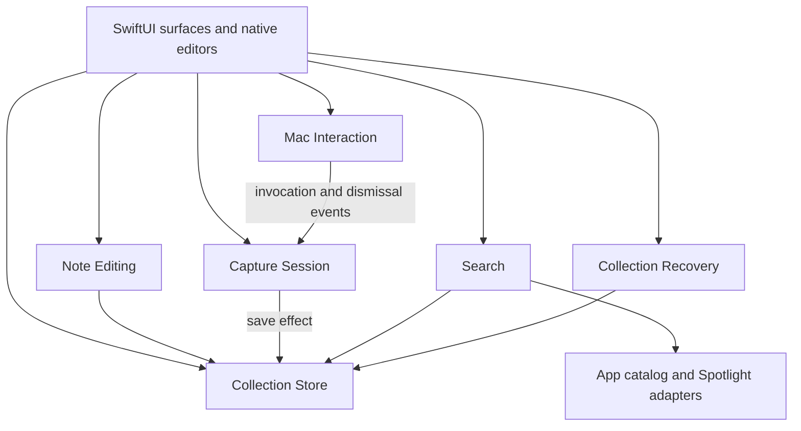

# Technical design

2026-10-13. The bounded #2 milestone now includes mixed Search, exact-destination opening and validation working windows; #10 records integrated verification. The [product specification](product-spec.md) is authoritative. [ADR 0001](adr/0001-own-tasks-and-notes.md) establishes ownership of notes and tasks; this document explains how to deliver that scope.

## Recommendation and decision status

Build a Swift macOS app with AppKit owning windows, focus, and text input, and SwiftUI composing the organizer, results, and controls. Keep one persistent transforming `NSPanel`, one main `NSWindow`, and at most one working `NSWindow` per note. Store the collection transactionally in SQLite through GRDB. Use Spotlight file metadata for files, an application catalog for apps, and a local collection search for notes/tasks. Merge their candidates with deterministic ranking.

**Accepted product clarification:** Beam's final answer in this design session requires a Dock icon and Command-Tab access while working windows are open. This replaces the earlier menu-bar-only answer. Closing working windows must leave global invocation and menu-bar access available.

**Selected engineering decisions:** the hybrid native UI, transactional owned collection, and direct-installed nonsandboxed personal app are accepted design choices under the instruction to make routine engineering recommendations. They are recorded in [ADR 0002](adr/0002-appkit-windows-and-native-text.md), [ADR 0003](adr/0003-transactional-local-collection.md), and [ADR 0004](adr/0004-direct-installed-personal-app.md). This is design acceptance, not evidence that they work on the target Mac.

**Proposed, unresolved implementation choice:** start with one process, using accessory activation while only the bar/menu bar are needed and regular activation while working windows are open. [ADR 0005](adr/0005-activation-policy-and-working-windows.md) remains proposed while integrated native acceptance and the documented environmental limits are assessed. If regular activation prevents the bar from appearing correctly over another app's full-screen Space, use an accessory bar helper plus a regular organizer process. Preserve the accepted experience; do not silently drop Dock access or full-screen invocation.

Animation values, performance budgets, filter controls, editor timing, and the particular panel flags below are engineering starting points to validate, not additions to the interview's accepted interaction details. No further product-discovery question is pending.

## Environment and evidence limits

Initial read-only inspection of this workspace and Mac produced the following on 2026-10-13. The toolchain rows are historical; the subsequent installation is recorded below.

| Check | Observed result | Consequence |
| --- | --- | --- |
| Workspace | Four starting Markdown documents; no app code or `.git` directory; no applicable `AGENTS.md` found in the project or inspected ancestors | No existing implementation to preserve or assess |
| `sw_vers`, `uname -m` | macOS 26.4.1, build 25E253; arm64 | Initially target this Apple Silicon Mac and macOS 26; older OS/Intel support is not a v1 commitment |
| `xcode-select -p` | `/Applications/Xcode.app/Contents/Developer` | This is the selected development directory |
| `xcodebuild -version` | Xcode 15.0.1, build 15A507 | Selected toolchain is substantially older than the running OS |
| `xcrun swift --version`, SDK | Swift 5.9; SDK 14.0; compiler printed target `arm64-apple-macosx16.0` | Record the discrepancy as observed; do not infer modern toolchain compatibility from the OS version |
| `mdutil -s /` | Indexing enabled | Does not prove coverage, freshness, or the future app's permissions |
| `mdfind` metadata probes | 666 application-bundle matches; 51,892 `README.md` matches; one `TextEdit.app` match | Metadata search is alive in the command's security context; counts are not an app inventory or completeness test |
| `mdls /System/Applications/TextEdit.app` | Filename returned | System apps must not be assumed to live only in `/Applications` |
| `sqlite3 --version` | 3.51.0 | CLI observation only; inspect the SQLite actually linked by the future app separately |

The initial Xcode 15 toolchain was insufficient for the macOS 26 SDK and GRDB's Swift 6.1+/Xcode 16.3+ requirement. No tools, permissions, signing settings, or Spotlight settings were changed during the architecture-only work. [GRDB requirements](https://github.com/groue/GRDB.swift#readme).

**Toolchain follow-up, 2026-10-13 — resolved:** installed Apple's Xcode 26.6 archive as `/Applications/Xcode-26.6.app`, preserving Xcode 15 at `/Applications/Xcode.app`. Apple's [compatibility table](https://developer.apple.com/xcode/system-requirements) lists Xcode 26.6 as supporting this macOS 26.4.1 host. The archive signature reported signed Apple software, and the installed app passed deep/strict code-signature verification. Beam completed Xcode's first-launch setup. Xcode Settings → Locations selected the new command-line tools globally.

Verification without a `DEVELOPER_DIR` override:

| Check | Observed result |
| --- | --- |
| `xcode-select -p` | `/Applications/Xcode-26.6.app/Contents/Developer` |
| `xcodebuild -version` | Xcode 26.6, build 17F113 |
| `xcodebuild -checkFirstLaunchStatus` | Success |
| `xcrun swift --version` | Apple Swift 6.3.3; target `arm64-apple-macosx26.0` |
| `xcrun --sdk macosx --show-sdk-version` | 26.5 |
| `xcrun clang --version` | Apple clang 21.0.0 |
| Disposable compile/run outside the project | Swift 6 language mode, macOS 26 deployment target, AppKit/SwiftUI imports, and SQLite FTS5 create/insert/query all passed; linked SQLite runtime 3.51.0 |

This resolves compiler/SDK readiness. App signing identity, package resolution/pinning, and native UI behavior remain implementation-phase checks. No app code or build scaffold was added to the project.

In this document, **documented** means supported by primary documentation, **observed** means inspected here, and **prototype required** means behavioral evidence is still missing. SDK availability and a successful build would not prove correct focus, Spaces, or indexing behavior.

## Native windows and application lifetime

### Framework split

Use an AppKit application delegate and window controllers for lifetime and activation. Embed SwiftUI with `NSHostingView`; Apple documents this integration and its layout/event coordination. Use SwiftUI for lists, navigation, settings, confirmations, and result rows. Use `NSTextView` through an AppKit-backed view for both the bar editor and working-note editor. Its input system exposes composition, insertion, selection, undo, and responder control. [NSHostingView](https://developer.apple.com/documentation/swiftui/nshostingview), [NSTextView](https://developer.apple.com/documentation/appkit/nstextview).

A pure SwiftUI window/`TextEditor` implementation would reduce bridging, but pushes the hardest requirements—stable editor identity through transformations, exact Enter behavior, input provenance, and nonactivating focus—behind less direct controls. Pure AppKit would also work, but adds unnecessary organizer layout work. `NSDocument` is not the collection model: notes belong to one database, and export files are copies rather than independently edited source documents. Avoid a web editor for v1.

| Surface | Lifetime and behavior |
| --- | --- |
| Transforming bar | One retained panel, created once; hidden between invocations. A new capture session each time; never restore its text after dismissal/relaunch. It can become key but does not become the app's main window. |
| Main window | One ordinary titled, resizable window; Notes and Tasks navigation, Completed and Archive views. Closing hides/releases the window without quitting the utility. |
| Note windows | Registry keyed by note ID; opening an existing window brings it forward. Ordinary titled/resizable windows, Enter inserts newline, edits autosave. Multiple different notes may remain open. |
| Menu-bar item | Always available while the process runs: Search, main window, open-note window list, Settings, Quit. No dependence on a visible working window. |
| Settings | Ordinary window with shortcut, permission/search diagnostics, export, backups and restore. Count a visible Settings window as a working window for activation policy. |

**Proposed activation implementation:** enter regular activation before showing the first working window. Keep regular activation while any working window is open, including minimized windows. Once the last closes and pending edits are safe, return to accessory mode. The bar alone does not produce a Dock icon. A Dock click reopens/raises the organizer; Command-Tab returns to the last working window. Never switch policy merely because the bar appears while working windows exist. Apple documents that accessory apps have no Dock icon and can still activate through their windows; policy changes and their interaction with full-screen Spaces need the first prototype. [Activation policy](https://developer.apple.com/documentation/appkit/nsapplication/activationpolicy-swift.enum/accessory).

Do not launch a second app process by accident; use normal app launch behavior plus a store ownership lock as defense. No helper, XPC, login item, or package scaffold is created in this design turn.

### Bar geometry and animation

Create a borderless, nonactivating `NSPanel`, with explicit key eligibility and an AppKit-controlled editor responder. Start by testing `.floating` level and collection behavior allowing other apps' full-screen Spaces (`.canJoinAllApplications`, `.fullScreenAuxiliary`) and the necessary Space membership (`.canJoinAllSpaces`). These are candidate settings, not a verified recipe. Do not combine mutually exclusive collection flags or change the nonactivating style during a session. Apple's documentation describes eligibility, not a guarantee for every full-screen app. [Nonactivating panel](https://developer.apple.com/documentation/appkit/nswindow/stylemask-swift.struct/nonactivatingpanel), [canJoinAllApplications](https://developer.apple.com/documentation/appkit/nswindow/collectionbehavior-swift.struct/canjoinallapplications).

An Apple DTS forum response reports a configuration using accessory activation and a much higher window level on macOS 26. Treat that as diagnostic evidence for the prototype, not a reason to ship a screen-saver-level overlay or abandon Dock access. Determine the lowest level that works without covering system alerts, input-method candidate windows, or lock/login surfaces. If the normal-window configuration fails the accepted experience, resolve the process design before building the organizer. [Apple DTS discussion](https://developer.apple.com/forums/thread/826308).

Keep the editor instance, selection, marked text, and undo history alive through mode changes. Position controls around a fixed input origin; the leading mode icon occupies a fixed gutter so changing mode never shoves existing text sideways. Empty Search paints only the mode icon, the input and its "Search" placeholder—no results, suggestions, or shortcut hints. The placeholder hides during input-method composition as well as when text exists. Expand primarily below the input, then sideways if needed. At screen edges, clamp to usable display bounds and accept only the movement necessary to remain visible. Long notes scroll inside a capped height.

The bar is a translucent rounded bezel—a behind-window `NSVisualEffectView`, masked to its corners, under a 35% white tint—holding one opaque white content card that grows below the input for results, with dark accessible text and system typography. Text and controls sit only on the opaque card; the material is never vibrant content. Use the native window shadow rather than a painted one, so shadow pixels never become part of the panel's click area, and invalidate it when geometry changes. The tint is lighter than the Figma frame's 72% so the blur shows through the 4-point ring. The native shadow's edge outlines the bezel, so no hairline is painted: Figma's 8% hairline only added a faint inner line beside it. The bar forces the light appearance, so its explicit colors stay legible in Dark Mode. Honor Reduce Motion with immediate or very short geometry changes. Start with approximately 180 ms transformations, measure, and revise. Animate geometry without rebuilding the editor or putting database/search work on the main actor.

## Invocation, focus, dismissal, and displays

### Global shortcut

Use the public HIToolbox `RegisterEventHotKey`/`UnregisterEventHotKey` functions behind the platform module, starting with Option+Space. Prefer exclusive registration; surface registration conflicts and retain the previous working shortcut if a new one fails. Store the key code/modifier combination and display it for the current input source. Register on the main thread, ignore auto-repeat, and test input-source changes. A shortcut recorder must validate before committing the preference. Menu-bar invocation remains available if registration fails.

The local SDK documents exclusive registration and conflict errors in `CarbonEvents.h` at lines 15428–15492. Apple's engineer initially described an Option-only restriction in Sequoia, then explicitly reported its removal in 15.2 beta 2. Therefore retain the specified default, but test registration and actual delivery on macOS 26.4.1, including repeated sleep/unlock cycles. Do not claim that Accessibility permission is required for ordinary hotkey registration. [Apple engineering update](https://developer.apple.com/forums/thread/763878).

Do not implement a hotkey by globally observing every key. Apple's global event monitor cannot suppress another app's event and has extra restrictions for keyboard events. Use local keyboard handling inside the bar; mouse-only observation may supplement dismissal while the panel is visible. [Event monitoring](https://developer.apple.com/library/archive/documentation/Cocoa/Conceptual/EventOverview/MonitoringEvents/MonitoringEvents.html).

### Focus is a session, not a delayed activation call

At invocation, capture a session ID, prior application identity, any prior window/responder owned by this app, current working-display evidence, and the activation policy. Determine placement before ordering the panel. Show it, make it key, and explicitly make the text view first responder. Do not blanket-activate the entire app for ordinary bar invocation. `makeFirstResponder` is the documented way to select the editor; the nonactivating panel's ability to receive typing over other apps remains a prototype requirement.

Each close has a reason and a destination:

| Event | Text and focus outcome |
| --- | --- |
| Escape with no active composition | Discard unsaved capture; hide; return keyboard control to the invocation origin when it is still appropriate |
| Outside click or user switches apps | Discard unsaved capture; let the clicked/new app receive focus; never activate the old app over the user's new choice |
| Successful ordinary capture | Commit, brief confirmation, close; return to prior app unless the user has already moved elsewhere |
| Open in window | Commit first, then open/activate the saved note's working window; do not return to prior app |
| App/file result | Request opening the selected destination; close on accepted launch/open; do not reactivate the invocation origin |
| Note/task result | Open note window or reveal task in main Tasks view; enter regular app mode |
| Failure | Keep text/result context and explain retry; never show success for an uncommitted write |

Use the invocation token to prevent an old save/animation callback from dismissing a newer bar or restoring stale focus. Reactivation is best effort if the origin app exited. Restoring a third-party app's exact insertion point is not guaranteed; avoiding unnecessary activation is preferable to trying to reconstruct it. App activation can fail even through public calls. [NSRunningApplication activation](https://developer.apple.com/documentation/appkit/nsrunningapplication/activate(options:)).

Detect outside clicks both in this app and other apps, and observe key loss/Space and app transitions. A nonactivating panel cannot rely solely on the owning app's resign-active notification. Remove temporary observers when hidden. Treat editor context menus, input-method candidate UI, filter menus, and owned popovers as part of the session; their temporary key changes must not discard text. Escape first dismisses composition/candidate UI, then the capture on a subsequent Escape. Prototype these distinctions with actual native input methods.

Repeated invocation while visible should bring focus back to the existing session, without resetting or discarding text; this is a proposed safe default for a configurable shortcut, not a second capture mode. A new session starts only after dismissal. On screen lock, discard unsaved capture and hide. On a Space change, dismiss rather than leave the bar following the user indefinitely; verify transitions triggered by opening a destination are not misclassified as user cancellation.

### Display selection and permission

For an app-owned focused window, use its screen. For another app, when Accessibility access is available, read only its focused window's geometry with AX and choose the screen with the greatest overlap. Use a bounded lookup; unresponsive apps, missing attributes, minimized/no focused windows, and denied/revoked permission all trigger the accepted pointer-display fallback. Capture pointer position at invocation. Map AX top-left coordinates to AppKit coordinates carefully, including screens left of or above the primary display. Use the chosen screen's `visibleFrame`, not a hard-coded main monitor rectangle.

Apple documents `NSScreen.main` as the screen of the keyboard-focused window, but that alone does not establish cross-process focused-window attribution under all activation states. It is useful supporting evidence, not a substitute for testing. Do not assume `screens[0]` is the working display. [NSScreen.main](https://developer.apple.com/documentation/appkit/nsscreen/main).

Offer optional Accessibility access for focused-window placement, with a clear explanation and an explicit Settings action. Continue using pointer placement when denied; no mandatory permission wall. Trust checks and AX attribute reads can fail independently, so a previously granted permission is not proof that a window read will succeed. Never request Accessibility solely to run collection features. [AX trust checking](https://developer.apple.com/documentation/applicationservices/1459186-axisprocesstrustedwithoptions).

No screen capture is needed for placement. Do not add Screen Recording, Input Monitoring, Apple Events automation, or a private window-server interface as a shortcut. When a display is disconnected, cancel any placement animation, choose the fallback display, and clamp both the bar and stranded working windows. Validate mirrored displays, different scaling, menu-bar/Dock positions, Stage Manager, and the separate-Spaces setting.

## Mixed search

### Three sources, one result model

| Source | Recommended implementation | Coverage and failure contract |
| --- | --- | --- |
| Applications | Cached enumeration of `/Applications`, `/System/Applications`, and `~/Applications`, descending organizational folders but not app bundles; supplement with Spotlight application metadata | Localized display name, bundle name, bundle identifier, URL; app discovery outside common locations is best effort. Refresh on launch and relevant filesystem/workspace changes. No recursive crawl of the whole disk. |
| Files | `NSMetadataQuery` over `NSMetadataQueryIndexedLocalComputerScope`, matching filename metadata | Indexed local mounted volumes/home; no content search. Spotlight exclusions, stale indexes, permissions, offline volumes and cloud placeholders constrain results. |
| Notes/tasks | Query committed collection records plus derived search data within the collection store | All eligible owned items, independent of Spotlight readiness. Notes match title and, at lower priority, body; tasks match title. |

Apple documents metadata query gathering/live-update phases and indexed local scope. Querying Spotlight does not confer access to a returned file. Core Spotlight's app-content search is a different facility: it searches content supplied by the app, and does not replace general filename search. Do not index notes into system-wide Spotlight in v1; this avoids a second source of truth and unwanted stale archived results. [NSMetadataQuery](https://developer.apple.com/documentation/foundation/nsmetadataquery), [indexed scope](https://developer.apple.com/documentation/foundation/nsmetadataqueryindexedlocalcomputerscope), [Core Spotlight app search](https://developer.apple.com/documentation/corespotlight/building-a-search-interface-for-your-app).

On each edit, Search first rechecks and reranks the previous visible results against the new text, then delivers application results without a fixed debounce. Still-matching results remain while fresh source snapshots load; finished source snapshots replace them. Every batch matches its current request. Indexed-file queries start on typing pauses (#50), following Alfred's documented [Script Filter queue](https://www.alfredapp.com/help/workflows/inputs/script-filter/): when no edit arrived within the typing gap, the file query starts at once; otherwise it waits until the gap passes without another edit, then runs once with the latest text. Starting a newer query stops the previous one. The gap never delays application or retained results. Search times this with an injected clock (the real versus test clock seam below); the gap is 50 ms, and its value is recorded with the [#50 performance evidence](evidence/issue-50/validation.md). Both sources retain explicit query-generation cancellation and incremental results. Own the metadata query’s run-loop/notification lifecycle in the adapter; starting a query in an arbitrary Swift task is insufficient run-loop design. Snapshot bounded result attributes while updates are disabled, reenable promptly, and stop obsolete queries. Never send `NSMetadataItem` instances across concurrency domains. Notification batching is 20 ms, down from the documented one-second default. The query has no sort descriptors because Search ranks candidates itself; it requests name and type values with the query, since query values exist only for requested attributes. Keep file icon loading lazy and cached.

Build predicates from constant keys and bound/escaped literal user text. `*`, quotes, brackets, SQL syntax, and the mode prefixes must not become a query language. Match `kMDItemFSName`, returning display name/path/type metadata; do not accidentally match file contents or the full path when promising filename matching. Multiword filename tokens must all be present for the basic match. Exact, prefix and substring filename stages start together, each with its own candidate shortlist, so a result cap does not hide an exact match behind thousands of weak ones and strong matches never wait for broad gathering. Source status is complete only once every stage has finished; stages that finish early publish their results while others still load.

Use typed result IDs: note/task UUIDs; app/file resource identifiers plus volume identity where available, with normalized URL fallback. Deduplicate an app seen by both catalog and metadata; retain its exact URL so two versions do not launch arbitrarily. Include type and a disambiguating path/subtitle. Revalidate on activation; moved/deleted/unavailable results can fail. Use `NSWorkspace` to launch the chosen app URL or open a file with its default app. Record usage only after the open request succeeds; that acknowledgment does not prove the target app displayed the document. [App launching](https://developer.apple.com/documentation/appkit/nsworkspace/openapplication(at:configuration:completionhandler:)), [opening URLs](https://developer.apple.com/documentation/appkit/nsworkspace/open(_:)).

### Permissions and scope

Recommend a direct-installed, signed app without App Sandbox for this personal v1. The accepted broad-search experience and focused-window integration fit that model better than a sandboxed app built around persistent folder grants. Hardened Runtime and, if distributed beyond local development, Developer ID signing/notarization remain separate concerns. Apple requires sandboxing for Mac App Store distribution and documents restrictions on assistive Accessibility use; unsandboxed distribution does not bypass macOS privacy controls. [Sandbox restrictions](https://developer.apple.com/documentation/security/protecting-user-data-with-app-sandbox), [distribution options](https://developer.apple.com/documentation/xcode/preparing-your-app-for-distribution).

No folder-selection setup is required to start searching. No Full Disk Access requirement is assumed. Test Desktop/Documents/Downloads, indexed external media, and cloud-backed filenames in the signed app's identity. If a protected location cannot be searched/opened, show the actual limitation and an actionable permission explanation. Full Disk Access, if a measured use case needs it, is a user Settings choice, not an entitlement or a guarantee of all results. Do not imply it overrides POSIX permissions, Spotlight exclusions, or offline providers. The terminal probes above may have a different permission context. [Apple file-access constraints](https://developer.apple.com/documentation/security/accessing-files-from-the-macos-app-sandbox).

Default file results should omit hidden items, Trash, app-bundle internals, and this app's database/backups. Include ordinary user-visible file types and folders; do not silently reduce mixed search to a small document whitelist. Application bundles are represented as apps. Indexed results also omit dependency, build and system locations (#56), because real queries showed clutter: Spotlight had 45 files named exactly `te` plus an extension: locale files in `node_modules` across at least 8 projects (including projects inside iCloud Drive), Perl and JSON resources under `/System/Library`, and editor history under `~/Library/Application Support`. None is a plausible search target, and the opt-in live test (`HANA_LIVE_INDEX`) checks that a `te` query returns none of them. Exclude any path containing a folder named `node_modules`, `Pods`, `DerivedData`, `.build`, `target`, `vendor` or `dist`, and that folder itself, matching the whole name without case sensitivity (`distance` and `targets` remain). Exclude anything under `/System`, `/Library` and `~/Library`, except `~/Library/Mobile Documents` (iCloud Drive, which holds Desktop and Documents when they sync) and `~/Library/CloudStorage` (Dropbox, Google Drive, OneDrive and other file providers); dependency and build folders are still excluded inside those two. These path checks extend shared eligibility for indexed results only. The Spotlight adapter applies them before its candidate shortlist and Search applies them to file-source results before ranking and the visible limit, so excluded candidates never take shortlist places. Hidden-item and package-ancestry checks read the filesystem, so the adapter runs them only on shortlisted candidates, caching verdicts per parent directory for the query's lifetime; an excluded candidate frees its place for the next one. They never remove applications in the catalog's conventional roots, whether the catalog or the index supplies them, so `/System/Applications` and `/System/Library/CoreServices/Applications` stay searchable. Finder (`/System/Library/CoreServices/Finder.app`) is likewise retained, since only the index supplies it; other applications elsewhere under `/System` are excluded. Network-wide search and cloud download management are not first-version dependencies; ordinary indexed local representations may still appear.

### Filtering and ranking

Start each invocation with All types and completed tasks excluded. Proposed controls are a keyboard-accessible type filter (All/Apps/Files/Notes/Tasks) and Include Completed option, revealed after typing or through a menu command, preserving input-only empty Search. Archive is searched in the Archive view; no global archive toggle is needed initially. Apply eligibility before limiting candidates. Include Completed never implicitly includes archived tasks.

Normalize for matching without rewriting stored text: canonical Unicode normalization, appropriate case folding, and careful language-aware handling of diacritics. Test Thai alongside Latin rather than stripping all combining marks. Use literal normalized substring matching on note/task titles as a correctness path; FTS5 can accelerate body/token candidates but must not be the only path for Thai, punctuation, or partial words. Derived search data is rebuildable and updated in the same transaction as content. SQLite's FTS5 provides token/prefix search; its default tokenizer is not a promise of language-specific segmentation. [FTS5](https://sqlite.org/fts5.html).

Search ranking (#48) compares the best match among a result's display, bundle, localized and filename aliases. Its tiers are: **0** exact normalized name; **1** name starts with the whole query; **2** every query word starts a word, in any order; **3** every query word appears anywhere; **4** query matches only a file extension. Word starts come from the system's language-aware `CFStringTokenizer` word units, including Thai segmentation, plus lowercase-to-uppercase transitions. Normalize word boundaries with the same canonical mapping and case folding as queries. Substring matching remains the fallback when segmentation is imperfect. Application names are prepared when the catalog loads and reused across requests.

Strip a suffix only for files and only when `UTType(filenameExtension:)` returns a declared type. Match both the full filename and the stripped name, keeping the best tier, so `report.pdf` still matches exactly while `pdf` alone places `Taxes.pdf` in tier 4. Folder and application names and unrecognized suffixes such as `.14` remain intact. Within a tier compare: kind (applications first, slot 1 reserved for notes/tasks, folders and files equally at slot 2); leftover name length (extension-stripped for files); query words in name order; session successful-use recency; count capped at 10; then stable destination path. One exception precedes the tiers (#55): an application whose best tier is 0, 1 or 2 ranks above every non-application result (today, folders and files), whatever that result's tier, so `te` puts Telegram above `te.js` and `code` puts Visual Studio Code above `code.txt`. Promoted applications keep the ordinary order among themselves (exact, then prefix, then word start). Applications matching only by substring (tier 3) are not promoted; they rank among folders and files by tier, then kind, so `far.txt` precedes Safari for `far`. The accepted trade-off is that a word-start application outranks an exactly named file or folder: `notes` puts Sticky Notes above a folder named Notes until the user types more or persistent usage exists. Otherwise kind, closeness and usage never move a result into a stronger tier, and usage never moves a result across the promotion, so a frequently opened weak (substring or extension-only) match cannot outrank an exact title. The Spotlight adapter's 256-candidate shortlist uses this same ordering before the 20-result visible limit. Persistent usage, fuzzy matching and adding collection/body results remain separate work. Pins organize Notes; they do not override search relevance.

Creation suggestions are ordinary selectable actions below every actual match, with simple deterministic rules and no model dependency. Never automatically change mode or put a suggestion above a matching item. Empty queries produce nothing. Each query edit selects the first currently displayed row and resets scrolling to the top; a replacement batch then follows the selection rules below. Until the user navigates with arrow keys or the pointer, selection follows the first row of each batch. After navigation, keep the selected result ID across batches until the next edit. If that result disappears, select the first row and resume following it. Enter captures the visibly selected result when handled; later batches cannot change that open intent. The one exception is a held Enter on an outdated row, described below, which opens the row selected once the current request's results arrive.

Start with 20 visible results and bounded candidate batches; these are tunable budgets. Per Beam’s 2026-10-14 follow-up to #49, Mac Interaction keeps the entire displayed list on typing and backspacing, including rows that no longer match the edited text. This supersedes #49’s original immediate-removal presentation rule. Search still emits only current-query matches: the previous list is a presentation snapshot, not part of the new query’s candidates. Replace the displayed list together when the first source-update batch contains a visible match supplied by a source for the current request. Search marks whether a batch contains such fresh results; rechecked cached rows alone do not count. Ignore empty or cache-only intermediate batches while either source is loading; if both finish without matches, replace the list with the no-results state. Enter opens the visibly selected row only when it appeared in a Search batch for the current request, including Search's rechecked first batch, so a retained row that still matches opens immediately (#53). Enter on an outdated retained row is held: the rows stay as they are, the opening status is shown, and when the current request's first batch with fresh results arrives, the row selected under the usual selection rules opens. A further query edit, Escape or dismissal cancels a held Enter; so does both sources finishing without matches, which shows the no-results state and opens nothing. Session usage is therefore recorded only for an acknowledged open of a result that matched the request it was opened in. The card grows as soon as content needs more space and keeps its height while either source is loading; it fits smaller content only after both sources report ready, partial or failed. Clearing the query collapses to the empty bar. Loading appears as a small input-row indicator and occupies no status row. Show no-results text only after both sources finish; source failure, partial-limit, opening and open-failure messages retain their status row. Indicate unavailable file results without blocking local search. A timeout is not “no files exist.” Keep local result delivery and typing independent of Spotlight lag.

## Capture and editing

### State and transitions

The Capture Session module owns one in-memory buffer, mode, prefix eligibility, selection, task destination, operation ID, and submission state. It accepts semantic events and returns the next state plus requested effects. Window code does not parse prefixes or decide whether something is saved.

| State/event | Transition and invariant |
| --- | --- |
| Hidden → invoke | Search with empty buffer, prefixes armed, default filters, task destination Inbox |
| Search + typed prefix at offset zero | Consume `-`/`[` into the mode label; retain other text and selection consistently; enter Note/Task |
| Search + paste/drop/undo/programmatic insertion | Insert text literally, without prefix recognition; preserve current mode |
| Explicit mode switch or capture suggestion | Keep buffer; explicit return to Search disables prefix recognition for the remainder of this invocation, even after clearing text |
| Any request to enter Task with multiline content | Reject transition; retain original mode, text, selection and undo; explain the single-line requirement |
| Note + Shift+Enter | Insert newline |
| Note/Task + Enter, or Note + Open in window | Validate, freeze submitted revision, issue one idempotent save; Enter during IME composition commits composition only |
| Saving + repeated Enter | No duplicate operation |
| Save success | Confirmation, then close or open saved note window; clear capture memory only after commit |
| Save failure | Editable error state containing the same text and mode; retry safely |
| Search + Enter | Activate selected result/action; no implicit capture of unmatched text |
| Dismiss while editing | Discard buffer; no database row, draft, restoration payload, or backup content |

“Typed prefix” means a direct single-character text insertion at the start while prefixes are armed, not merely finding the character in the buffer after a change. Route paste, drag/drop, replacements and undo through separately identified editor operations. IME composition must not trigger mode switches midway; when composition provenance is uncertain, preserve literal text. Test the native insertion path instead of inferring typing from a raw key code. [NSTextInputClient](https://developer.apple.com/documentation/appkit/nstextinputclient).

Returning to Search from a multiline note must preserve all text. Proposed presentation: retain enough editor height to show that multiline buffer and normalize whitespace only in the derived search query. Switching to Task still fails until the actual buffer is one line. In Task, reject multiline paste as a whole with an explanation; never flatten it or silently save the first line. Treat CR, LF, CRLF and Unicode line separators consistently. Soft wrapping is not a newline.

Reject whitespace-only new captures; preserve intentional content and Markdown whitespace otherwise. Derive a note's title from its first nonempty line, trimming surrounding title whitespace without modifying the body; no independent title editor in v1. Existing notes may become empty and then display “Untitled.” Cap title display visually, not by truncating saved content.

A save is explicit commitment intent. Before submission Escape/outside click discards; after submission starts, serialize dismissal with the save result instead of pretending that an already committed write was cancelled. Briefly defer hiding during the write, preserve text on failure, and do not steal focus back if the user clicked elsewhere. If the write stalls, display its state and offer retry only after determining its outcome using the operation ID. This race policy is a proposed implementation detail requiring validation. A failed capture is not silently persisted as a draft.

### Working-note editor and autosave

Use plain-text `NSTextView` with Markdown syntax always present. Preserve native undo/redo, selection, spelling, and composition. Disable substitutions that unexpectedly change Markdown punctuation. Source text is authoritative; highlighting and preview never rewrite it. Start with TextKit 2 and avoid accidentally invoking TextKit 1 compatibility paths; validate long documents before adding elaborate syntax decoration. Apple documents the text-system fallback behavior. [NSTextView](https://developer.apple.com/documentation/appkit/nstextview).

Optional preview belongs only in working-note windows. Recommend Swift Markdown parsing and a native read-only block renderer for headings, paragraphs, lists, quotes, code and links. Preserve unsupported constructs literally; raw HTML is text, and remote images are not fetched automatically. This is a text/Markdown notebook, not an attachment or browser engine. Parse off the main actor and discard stale results by content revision. Parser choice and precise preview coverage remain replaceable implementation details. [Swift Markdown](https://github.com/swiftlang/swift-markdown).

Use one editing session per note ID shared by every surface, with monotonically increasing revisions. Start with a 300 ms idle autosave and a maximum 1 second dirty interval during continuous typing. Enqueue saves in order; older completions may not mark newer text as saved. Flush on close, app deactivation, export, backup/restore preparation and orderly quit. “Saved” means the transaction completed, not that text reached an observable model. A force quit can lose only uncommitted edits within that window; no debounce can promise zero loss before commit.

On save failure keep the existing note's dirty text in its live editor, show Retry/Copy text, and prevent ordinary close/quit from silently dropping it. This differs from the explicitly disposable new capture. Use deferred termination while flushing; a forced process kill cannot be prevented. Archive from another surface must flush first and then make an open note read-only or close it safely. Restore/collection replacement invalidates every editor revision; old callbacks may not write into the restored collection.

## Collection model and persistence

### Domain records and rules

Separate archive state from completion and task placement. There is no overloaded `status = archived` that erases whether a task was finished.

| Record | Persisted facts |
| --- | --- |
| Note | UUID, Markdown/plain-text body, creation time, content-edited time, overall updated time, revision, pin flag, nullable archived time; derived title/search fields may be cached |
| Task | UUID, single-line title, creation/content-edited/updated times, revision, nullable completion time, nullable archive time, placement (`inbox`/`today`/none), nullable manual-order key |
| Capture operation | Unique operation UUID associated with created item ID, enabling safe retry after uncertain acknowledgment |
| Usage | Typed result identity, successful activation count and last-used time; no raw query history |
| Store metadata | Schema version, collection identity, migration history; active store-generation identity is managed outside the replaceable database |

Store timestamps as UTC instants and display in the user's local calendar/time zone. Today is membership, not a due date and not midnight scheduling. Content-edited time drives Notes sorting; pin/archive metadata changes should not pretend that the writing itself changed. Pins come first, then content-edited time and ID for stable order.

| Operation | Exact result |
| --- | --- |
| Create task | Unfinished, Inbox unless Today explicitly selected, inserted at top |
| Move Inbox ↔ Today | Unfinished task moves to top of destination; preserves creation time |
| Complete | Set completion time; clear active placement/order; appears in Completed |
| Reopen completed task | Clear completion time; Inbox at top; not previous Today placement |
| Archive task | Set archive time; preserve completion time; clear active placement/order |
| Restore archived unfinished task | Clear archive time; Inbox at top |
| Restore archived completed task | Clear archive time; retain completion time; Completed |
| Archive/restore note | Preserve body, pin and content-edited time; hide/rejoin Notes |

Require restoration before editing/completing archived tasks. Archived notes are readable/exportable but must be restored to edit. These defaults prevent hidden changes to archival state and keep commands unambiguous. There is no permanent-delete command.

For manual ordering, use integer keys within each active task list; new/moved items get a key before the current first item. Reorder and any needed renumbering happen in one transaction, with stable ID tie-breaks. No fractional-indexing or distributed-ordering scheme is needed without sync. Export the order keys. Completed/Archive views use completion/archive time respectively and do not add manual ordering scope.

Enforce in the store and schema that only unarchived unfinished tasks have placement/order, and every such task has both. Completion and archive times remain independent. Archive/restore updates the record revision so a stale inline edit cannot undo a status change. The process-local generation token changes on every store replacement even if the restored database contains an older record with the same revision number.

### Storage choice and durability

Use SQLite with GRDB behind the Collection Store module, including migrations, observation, search tables, and backup operations. Recommend `DatabasePool` with serialized writes and short snapshot reads so search/export do not hold up editing; keep all connections private. Maintain a maintenance gate for migrations and restore. SQLite WAL plus `synchronous=FULL`, foreign keys, check constraints and explicit transactions form the initial configuration. Test the actual linked runtime and checkpoint strategy. Database errors roll back domain commands; migrations never use destructive “erase on schema change” development shortcuts. [GRDB](https://github.com/groue/GRDB.swift#readme), [SQLite WAL](https://sqlite.org/wal.html), [synchronous setting](https://sqlite.org/pragma.html#pragma_synchronous).

Compared with SwiftData/Core Data, explicit SQL makes independent completion/archive rules, consistent exports, store replacement and recovery inspectable without depending on framework-managed persistence behavior. Compared with one Markdown file per note plus task JSON, it supplies atomic multi-item changes and one consistent snapshot. The trade-off is owning schema migrations and a dependency; keep that complexity inside one module. Markdown files remain the portable export, not live storage.

For local development use an app-specific Application Support directory, never the repository or an iCloud-synchronized folder. Choose a stable bundle identity before collecting real data. Use a private directory and owner-only file permissions; backups/exports contain readable personal content and v1 has no separate application-level encryption. Apple recommends protected app-group containers for nonsandboxed apps on newer macOS; adopt one when signing/entitlement setup is established, or document the standard Application Support location as the personal-build fallback. Storage location is internal and must have a tested one-time migration before changing it. [Apple container guidance](https://developer.apple.com/documentation/xcode/protecting-local-app-data-using-containers).

App preferences such as shortcut/filter defaults and window frames may use UserDefaults. Collection organization, pins, order and timestamps belong in the database. Caches, app/file indexes and search usage are reconstructible or nonessential; they are not allowed to become the sole record of an owned item. Unsaved capture text must not enter UserDefaults, restoration, logging, crash breadcrumbs or backup payloads.

Before migration take a validated snapshot; migrate transactionally where possible; refuse an unknown newer schema. An opening failure must preserve the original store and offer recovery, never create an empty replacement and call it success. Immutable value snapshots cross concurrency seams; live GRDB rows and AppKit objects do not.

## Full export and 30-day recovery

### Export contract

Full export includes every note/task, including archived and completed items. Export from a consistent committed database snapshot after flushing existing-note edits; if flushing fails, stop and explain rather than silently omit them. Unsaved captures are excluded. Write to a new temporary directory on the destination volume, validate counts/hashes and schema, then publish the finished directory atomically where supported. Never overwrite a previous export in place.

| File | Contents |
| --- | --- |
| `manifest.json` | Format version, collection ID, export time, per-file hashes and record counts; note metadata mapping ID → Markdown path, title, pin, archive state, timestamps and revision |
| `notes/<UUID>.md` | Exact UTF-8 source text per note; IDs avoid filename collisions, invalid title characters and path traversal |
| `tasks.json` | Format version and every task's ID, title, completion/archive state, Inbox/Today placement, order and timestamps/revision |

For a single-note export, write the Markdown and a small metadata sidecar if preserving its organization is requested; full export always includes the manifest. Explicitly distinguish complete collection export from exporting external apps/files: external search results are references, not owned content. Export does not include application binaries, other users' files, permission grants, unsaved captures, or a promised raw search history. A round-trip test decoder must reconstruct all collection facts even though a general user-facing import feature is not part of v1.

### Snapshot scheduling and retention

Use the SQLite online backup facility via GRDB to create an independent destination database. Do not copy only the main SQLite file while WAL is live. Stage snapshots, close their connection, verify integrity and domain invariants, add a version/checksum manifest, then publish. A snapshot only becomes selectable after validation. Blocking backup work stays off the main actor; use a write barrier for a precise pre-restore safety snapshot. [SQLite backup](https://sqlite.org/backup.html), [GRDB backup behavior](https://github.com/groue/GRDB.swift#backup).

Recommended interpretation of daily retention: one verified snapshot per local calendar date, retain dates in the current 30-day window. On launch/wake, catch up for today; while running, check at date rollover. After the first committed change on a new date, ensure a snapshot exists. Never invent historical snapshots for days when the app was closed or the Mac was off. Store actual UTC capture time plus the scheduling date/time zone. No launch daemon is needed merely to copy an unchanged closed database. If uninterrupted daily capture while the app is quit later becomes a requirement, that is a separate background-lifetime decision.

Do not overwrite a valid daily snapshot with a partial attempt. Purge expired daily snapshots only after a new one validates; when backups are failing, retain existing recovery points and show the last successful time/error in Settings. Pre-restore and pre-migration safety snapshots are separate from the daily quota, retained at least 30 days from creation, including across a restore. Disk-full failure must not destroy the last good snapshot. Local backups protect against app mistakes and store corruption; a lost disk requires a copy elsewhere, such as the Mac's existing backup system.

### Restore is replacement, with a reversible handover

1. Inspect the selected snapshot, show its time and counts, and explain that it replaces the collection rather than merges it. Confirm the restore action in Settings.
2. Enter maintenance mode: stop new capture submissions, finish/cancel searches, flush existing editors, and fence pending work with a generation token. If flushing or safety backup fails, abort replacement and retain the live collection.
3. Create and verify a fresh safety snapshot of the current collection. Record its ID outside the database being replaced.
4. Copy the chosen snapshot into a new store-generation directory, check schema/integrity/domain invariants, and migrate that copy if supported. Never migrate the sole backup in place.
5. Close all live database handles. Publish a durable restore journal and atomically switch a small active-generation pointer to the validated directory. Do not rename a live database underneath WAL connections. Keep the previous generation until the new store opens successfully and the journal records completion.
6. Reopen, rotate the runtime generation token, invalidate old editors/search callbacks and refresh views. Close obsolete note windows or reload their restored note by ID only after their old session has been invalidated. Show the safety snapshot as the way to reverse the restore.
7. On launch after a crash, use the journal and validated generation pointer to deterministically finish or roll back. Never choose a store by the newest file modification time or merge WAL files from two generations.

The atomic-pointer approach and directory durability need filesystem crash tests; “rename is atomic” alone is not a power-loss recovery proof. The snapshot catalog lives outside the replaceable collection so restore does not erase its own undo path. Restoration must never resurrect discarded quick captures because they were never persisted.

## Module interfaces and seams

Organize by behavior, initially within one app target plus a small pure-domain test target/package when implementation starts. Do not make a framework, protocol and pass-through repository for every table or view. A **module** includes all behavior behind its **interface**; the **seam** is where callers and tests meet that interface. Introduce an **adapter** where behavior genuinely varies.

| Module | Interface callers learn | Depth and invariant ownership | Meaningful verification |
| --- | --- | --- | --- |
| Capture Session | `handle(event) → state + effects` | Prefix provenance, buffer preservation, mode validation, idempotent submission and dismissal rules. No disk or window calls inside the transition function. | State-transition scenarios through this interface; native editor tests separately prove event provenance |
| Collection Store | Typed `perform(command)`, `read(query)`, and `observe(query)`; internal exclusive snapshot/replacement operations for Recovery | All collection rules, transactions, revisions, migrations, ordering and committed search projection. Commands return committed result or typed failure; stale revision/generation rejected. | Real temporary SQLite stores, restart and migration fixtures; no mock SQL layer |
| Search | `search(request) → stream of result batches` with generation/cancellation and source status | Eligibility, merging, deterministic ranking, stable identity and suggestions; owns internal source adapters. Empty means no work/results. | Delayed/failing fixture source and actual Spotlight adapter, plus exact ranking cases |
| Mac Interaction | `presentBar(session)`, `dismiss(reason, destination)`, `open(destination)` and invocation events | Hotkey registration, window registry, activation policy, display geometry, responder ownership and origin focus. All AppKit work on main actor. | Geometry tests plus real-process/full-screen acceptance; a fake cannot establish native focus behavior |
| Result Icons | `icon(for: installationURL, scale) → icon value or nothing` | Presentation adapter only (issue #23): exact-installation workspace icon, rasterised off the main actor to an immutable bitmap; bounded in-memory LRU keyed by installation, scale and bundle/Info.plist stamps. No part in eligibility, ranking or batches; failure means the generic symbol. | Real temporary `.app` fixtures; Mac Interaction with a slow/never-completing provider |
| Note Editing | `open(noteID)`, edit events, flush/close, observable save state | One editor session per note, revisions, undo lifetime, autosave scheduling and Markdown preview cancellation | Deterministic clock-driven save races; real editor IME and native undo tests |
| Collection Recovery | `export(selection, destination)`, `listSnapshots()`, `restore(snapshotID)` plus status | Complete serialization, staging, verification, retention, safety snapshots and crash-safe store handover | Round-trip collection equality and fault injection at every publication/restore stage |

These are conceptual interfaces, not scaffolding or final Swift declarations. Typed commands retain domain meaning; a single generic dictionary-based “execute” method would merely hide a sprawling interface. The Collection Store should not expose SQLite handles to views, and Search should not make callers know query-run-loop details.

Use internal seams for actual variability: live Spotlight versus a controlled delayed/failing source; real clock versus a test clock; normal file operations versus a fault-injecting wrapper for recovery tests. Exercise the production SQLite adapter in temporary directories rather than maintaining a second in-memory business model. Inject dependencies at construction, but avoid protocols for hypothetical future sync/model providers. Dependency direction remains toward pure domain values.

If the helper fallback becomes necessary, retain one collection writer in the regular app/owner process and expose a narrow versioned XPC interface for capture/search requests. The accessory helper owns only bar UI/platform interaction and its disposable capture buffer. Do not let two processes independently autosave, migrate, or restore the collection. Client reconnection and idempotent save acknowledgment then become new required tests. This is a fallback design, not an accepted extra process today.

## Validation strategy

The initial architecture session used document review, primary documentation, SDK inspection and read-only probes. The subsequent [window/focus prototype report](https://github.com/beamseree/hana/blob/prototype/window-focus/prototypes/window-focus/TEST-MATRIX.md) records build checks, instrumented runtime events and user-observed keyboard behavior separately. Unlisted acceptance cases remain unverified.

Automate pure rules and persistence at their module interfaces. Use Swift Testing for deterministic rules and temporary-store tests, XCTest/XCUITest for native interaction and lifecycle tests, and manual scripts for operating-system behavior that automation cannot reliably establish. Avoid tests that merely restate view implementation. Measure with signposts/Instruments and opt-in diagnostic counters that omit captured text, filenames and query content.

| Risk | Required evidence |
| --- | --- |
| Activation-policy conflict | Invoke over another app's native full-screen window both with all working windows closed and with main/note windows open or minimized; prove Dock/Command-Tab access and no Space jump. Repeat after policy transitions. |
| Lost input/focus | Type immediately on invocation, switch modes while typing, compose Thai and an IME candidate sequence, use context menus, cancel, save, click another app during save. Show exact buffer and destination focus. |
| Prefix ambiguity | Typed versus pasted `-`/`[`, insertion at offset zero in existing Search text, explicit literal Search, undo/redo, replacements, multiline paste and CRLF. |
| Search correctness | Exact title outranks a frequently opened weak match (usage never crosses a tier or the application promotion); no archived/default-completed leak; stale batch cannot replace current query; selected item cannot change under Enter; Unicode and punctuation work. |
| File coverage | Signed app tests against known fixtures in user folders, external indexed volume, excluded folder, renamed/deleted file, duplicate filenames and cloud placeholder. Record found/opened separately; do not compare only with terminal counts. |
| Collection integrity | Complete/archive/restore/reopen matrix, midnight/time-zone changes leaving Today untouched, concurrent edit/archive, order persistence and repeated save acknowledgment. |
| Durability and recovery | Crash before/after commit, full disk, readonly destination, failed migration, corrupt snapshot, future schema, WAL activity, export during edits, and crash at every restore step. Original or fully restored collection must remain recoverable. |
| Rendering and usability | Upper display placement, negative screen coordinates, Retina/scaled screens, disconnect, Reduce Motion, VoiceOver labels, keyboard filter access, native undo and long-note scrolling. |

Initial engineering budgets, not measured claims: p95 invocation-to-typing readiness under 100 ms after warm launch; local matches under 100 ms from the edit, without a fixed app debounce; first indexed-file batch preferably under 300 ms on a warm index; no typing stalls over 50 ms attributable to app work. Measure cold-start separately. Slow Spotlight is an explicit partial-source state, not a reason to freeze the bar. Profile 10,000 owned items and a 1 MB note as stress fixtures without declaring those product limits.

## Phased implementation plan

The window/focus phase is now in progress in the isolated prototype; the remaining phases are future work. Do not build a broad organizer before the first two gates establish that the accepted entry experience is feasible.

1. **Toolchain and identity.** Supported Xcode/macOS SDK selection and a disposable native compile/run are complete (see environment follow-up). Decide stable bundle/signing identity and local data location, verify and pin dependency versions/licenses, and establish a test fixture area. Exit: reproducible native build/test environment and documented permission identity. App signing and package setup remain open.
2. **Window/focus proof, before storage UI.** Build the smallest disposable panel and ordinary working window experiment, with Option+Space, persistent text input, white morphing geometry and display selection. Exercise accessory ↔ regular transitions, Dock/Command-Tab, full-screen Spaces and focus restoration with working windows open. Exit: recorded pass/fail matrix on Beam's Mac. If one process fails, validate the accessory-helper fallback and resolve ADR 0005 before expanding the app. A fallback that materially worsens the experience requires a product decision; an internal process split does not automatically require one.
3. **Search and permission proof.** In the signed native identity, test app discovery, filename metadata coverage, default-app opening, denied/revoked permission and partial results. Measure exact/prefix query latency and candidate limits with mixed fixtures. Exit: coverage/permission report and ranked-result behavior. If desired essential file locations cannot be supported without a meaningful permission/scope change, raise that specific trade-off then.
4. **Collection and recovery foundation.** Implement domain commands and schema, idempotent capture, ordering, archive/completion matrix, migration, full export and daily/safety snapshots. Prove restart, round-trip export and interrupted restore before trusting the app with real notes. Exit: automated temporary-store and fault-injection checks, including no persisted unsaved captures.
5. **Capture vertical slice.** Connect the real editor, Capture Session, store and panel; add mode labels, destination selector, save confirmation/error behavior and Open in window. Exit: typed/pasted prefix matrix, IME/undo preservation, no duplicate saves, correct dismissal and destination focus under save races. Tune animation while exercising actual input.
6. **Working windows and organization.** Add Notes/pins, Tasks/Inbox/Today/Completed/Archive, inline task editing/order, one window per note, autosave and optional preview. Exit: edits agree across search/windows, failed saves cannot silently close, Dock/Command-Tab matches the accepted clarification, and recovery invalidates stale editors.
7. **Complete acceptance and hardening.** Run the specification's full loop on Beam's Mac: invoke from another app; launch/open; capture; organize; edit; reopen through search; restart; full export; restore and reverse via safety snapshot. Repeat full-screen/multi-display and crash cases with production signing/configuration. Record OS, build, permissions, recordings and measured timings. Only then call the v1 experience verified.

Complete the outstanding interactive window/focus gates before expanding implementation. The disposable prototype uses a local ad-hoc identity and no dependencies, so production signing/dependency setup does not block this experiment. Source completion, automated correctness and demonstrated native behavior remain separate milestones.

## Native prototype follow-up — 2026-10-13

The runnable, disposable [window/focus experiment](https://github.com/beamseree/hana/blob/prototype/window-focus/prototypes/window-focus/README.md) owns one retained AppKit nonactivating panel with a native text view, one ordinary main window and two independent mock note windows. It has an exclusive Option+Space registration and a WF menu-bar item. The registry counts minimized windows when choosing regular activation; zero working windows chooses accessory activation. SwiftUI adds no value to this small harness and is not used. This does not change the production framework choice.

The experiment concentrates presentation, dismissal and destination-opening behavior in one Mac Interaction implementation. There is no speculative helper protocol or persistence adapter. A dismissal reason determines whether the invocation origin is eligible for restoration; outside clicks never activate the old app. Native selection/composition remains in the same editor during resizing, and Escape reaches marked-text input before capture cancellation. These are implementation hypotheses until the corresponding interactive checks pass.

The selected toolchain was cheaply reverified: Xcode 26.6 (17F113), Swift 6.3.3, SDK 26.5, successful first-launch status, and macOS 26.4.1 (25E253) on arm64. A Swift 6 build, plist validation and strict ad-hoc signature verification passed. Runtime startup returned success for both hotkey-handler installation and exclusive hotkey registration. Three screens were reported, including negative horizontal coordinates; Accessibility trust was false and pointer fallback was used. No privacy or global Spaces settings were changed.

The user confirmed accessory-mode Option+Space invocation, typing, Escape and typing back in the invocation origin without a Space switch. Logs corroborate five inserted UTF-16 units and Escape dismissal with Figma still reported as the frontmost app. Automated shortcut delivery through the available UI tool did not reach the handler, so physical-keyboard evidence is explicitly separate. A successful responder assignment or screenshot is not treated as keyboard proof.

Beam subsequently confirmed full-screen invocation both without and with working windows, Dock/Command-Tab access, all-three-window minimization, post-last-close invocation, opening a note from the bar, repeated/rapid invocation, outside-click typing, selection/expansion and pointer placement on three displays. Runtime traces corroborate registry/policy transitions, native text events, same-session reinvocation, and placement on both external displays and the primary display. Some procedures received broad user confirmation without an isolated trace; the [test matrix](https://github.com/beamseree/hana/blob/prototype/window-focus/prototypes/window-focus/TEST-MATRIX.md) identifies those limits explicitly.

**Recommendation:** continue with the single-process architecture at `.floating`. No observed full-screen/Dock conflict warrants a helper experiment. The original unresolved evidence was: the final log contains one brief marked-text commit but no Escape during active composition or identified candidate-window sequence, and no enabled Japanese/Chinese composing source, and Beam reported an unexplained top-left destination during sequential bulk minimization. The native calls set no custom animation target. Do not hide that anomaly with animation suppression or an extreme window level. AX-focused-display placement, candidate/context-menu behavior, display disconnect, lock and Stage Manager remain untested.

**Next step:** carry the validated behavior toward Mac Interaction's presentation/dismissal/destination interface while retaining the unreproduced minimize report as an explicit observation. Candidate IME tests are deferred by Beam for English/Thai use; see the follow-up below. Neither the automation limitation nor the unresolved animation alone establishes that two processes are necessary.

### Validation scope clarification — 2026-10-13

Beam uses English and Thai and explicitly deferred candidate-based IME testing. Preserve native text input and record candidate UI / Escape during active composition as future compatibility work; do not keep this as a blocking gate for the current window prototype. Investigation now focuses on the reported top-left minimize-animation destination.

### Minimize follow-up — 2026-10-13

The [controlled investigation](https://github.com/beamseree/hana/blob/prototype/window-focus/prototypes/window-focus/debug/MINIMIZE-INVESTIGATION.md) compared Main's native yellow button, the original three-window bulk-minimize action and bulk minimization immediately after closing/reopening all working windows. Beam observed all three cases animate toward the Dock. The window implementation and system settings were unchanged. Runtime logs confirm minimized states and regular activation; the endpoint result comes from human observation. The original top-left report is not currently reproducible, and no root cause or fix has been established. Do not introduce timing workarounds or a helper based on this evidence. Retain the report and reproduction loop for recurrence.

## Native shell follow-up — issue #3

The first maintainable shell uses AppKit, one retained nonactivating panel/editor at `.floating`, accessory activation, exclusive Option+Space and menu invocation. It has no working windows, search results, collection, capture, or dependencies. The local identity is `com.beamseree.hana` at `~/Applications/Hana.app`, ad-hoc signed without entitlements; no certificate identity was available. See [reproducible commands](native-shell.md) and [current acceptance evidence](evidence/issue-3/validation.md).

Beam confirmed physical invocation, immediate typing and Escape return over normal and native full-screen apps, plus reinvocation, fresh reopening and outside-click typing. A controlled exclusive-registration conflict produced a visible warning while menu invocation worked. These are current shell observations, separate from the preserved #1 prototype. Deterministic Mac Interaction session checks and native editor UI checks add narrower automated evidence. Only one display was available; the prior three-display experiment is not repeated evidence here. ADR 0005 remains proposed, and later working-window/search integration still needs its own acceptance checks.

## Integrated Search validation — issue #10

The [integrated report](evidence/issue-10/validation.md) consolidates the merged #4/#7/#8/#9 implementation with PR #17 styling. Search and Mac Interaction remain the agreed behavior boundaries. The current implementation includes session-safe opening, a cached application catalog, staged indexed filename search and three validation-only working windows. Capture, SQLite/GRDB, persistence and the organizer are still future work; the earlier phase descriptions are historical plans, not claims of implementation.

A live Search responsiveness regression reproduced a 349 ms main-actor scheduling pause. A native sample traced the hot path to `NSMetadataItem.value(forAttribute:)` fetching content-type attributes synchronously. The adapter now requests the type tree with `valueListAttributes` and reads query-supplied name/type values. The item path lookup remains: the query-value API returned nil for paths on the tested OS even with a path sort descriptor. URL construction supplies the directory hint to avoid a main-thread filesystem inference. Query ownership, generation cancellation, complete replacement snapshots, ranking and visible limits are unchanged. [Apple's query-value API](https://developer.apple.com/documentation/foundation/nsmetadataquery/value(ofattribute:forresultat:)) requires requested/sort/group attributes; this capability is separate from the measured result. See the report for red/green tests and profiling evidence.

Opt-in timing records presentation-call and programmatic editor-call duration, first observable app/file results including the production typing gap and rendering, first file result after rapid typing (one character every 30 ms), local-only zero-gap Search service cost, and main-actor scheduling excess overall and during rapid typing. `--typing-gap-ms N` overrides the typing gap for comparison runs. Physical shortcut-to-typing p95 and app attribution of physical typing stalls require different evidence; fast presentation calls and responder flags do not establish either. Cold means a fresh process/catalog with unchanged OS/index caches. The report supplies sample counts, conditions, misses and remaining gates.

The single-process design remains at floating level. No helper, animation suppression, global setting change or new mandatory permission setup was introduced. Existing #9 grants/coverage are prior evidence, with ad-hoc rebuild continuity explicitly uncertain. The original top-left minimize report and #8's unreproduced automation-session foreign-focus failure retain their unknown causes; this performance fix is not a claimed fix for either observation.

Current integrated human observations confirm the six normal/full-screen × zero/open/minimized working-window combinations, Dock/Command-Tab and minimize transitions, native English/Thai editing/context menus, three-display placement, PR #17 styling, exact Two application destination, Documents folder destination and broken-application context retention. These grouped confirmations are separate from runtime flags. A later Downloads duplicate gap cleared in the same binary’s discovery/opening probe after Beam personally enabled Full Disk Access and restarted; this does not establish a mandatory FDA requirement or isolate the earlier cause. The report retains this permission transition and the later two-display timing conditions.

Later debug-process responsiveness checks still exceeded 50 ms; a short sample includes retained path-lookup mutex waits but does not correlate the worst interval. Two complete fixed release timing runs showed no heartbeat excess above 50 ms, including the post-FDA run. These different observations remain explicit; no universal typing-stall guarantee, physical latency p95, or helper-process justification follows from them.

Further isolation also reproduced an 89.78 ms heartbeat excess in the optimized test process, while idle and local-only controls passed. A smaller copy chunk failed and was reverted. The remaining indexed-search timing gap therefore is not explained solely by debug overhead, and its cause/fix remains unresolved. It is a draft-PR acceptance limitation; the complete installed-app runs do not cancel it.

The [timing follow-up](evidence/issue-10/timing-followup/validation.md) supersedes that draft-stage timing diagnosis with a more precise regression boundary: initialize AppKit, then measure ready callbacks from enqueue to main-queue execution. All 49 optional/deterministic tests pass; restoring the original type-fetch defect still fails the same 50 ms threshold. Sleep excess remains diagnostic, and its individual historical causes are not all established. No further production or threading architecture change is retained. Physical latency/stall targets remain unmeasured. The explicit follow-up received a definitive human pass for exact Two app selection through the late file batch, destination opening and typing without clicking.

On 2026-10-13, Beam explicitly deferred instrumented physical shortcut-to-typing and typing-stall measurements for this milestone. The [recorded decision](evidence/issue-10/validation.md#physical-timing-deferral--2026-10-13) removes the sole remaining PR draft gate; it does not establish the numerical targets or change the software measurements' meaning. Functional integration and review have no remaining known core failure. PR #19 is ready for review with recorded limitations; #2 remains open, and ADR 0005 remains proposed.

## Collection Store foundation — issue #24

The first Collection Store slice saves notes through typed `perform(command)`, `read(query)` and `observe(query)` on `CollectionStore`, each carrying the caller's `StoreGeneration`. This slice added `createNote(operation:body:)`, `note(id)` and active `notes`; note editing and organization follow in [#25](#note-editing-and-organization--issue-25), and tasks, export and snapshots belong to #26–#29. The [validation record](evidence/issue-24/validation.md) maps the acceptance criteria to tests and runtime output.

**Dependency and runtime.** GRDB.swift is pinned at exactly 7.11.1 (revision `b83108d`, MIT License) in `Package.swift`/`Package.resolved`. It links the system `/usr/lib/libsqlite3.dylib` (current version 382.0.0). The signed release app reports SQLite 3.51.0 with source ID `2025-06-12 13:14:41 f0ca7bba…aapl`, an Apple build. SQLite documents the [WAL-reset bug](https://sqlite.org/wal.html) in 3.7.0–3.51.2, fixed in 3.51.3; it needs two connections on one file both writing or checkpointing nearly simultaneously. **Vendor fix coverage for Apple's build is not established**: no public Apple source for this release was found, and its version predates the fix. Using a fixed build would require forking GRDB's package. On 2026-10-13 Beam chose to keep the system SQLite and exclude the trigger structurally:

- one `DatabasePool` writer is the only read-write connection; GRDB opens pool readers `SQLITE_OPEN_READONLY`, and a reader's checkpoint attempt returns `SQLITE_READONLY` (tested);
- an exclusive `flock` on the `Collection` directory prevents a second Store, in this or another process, from opening the root; existing-store validation uses a read-only connection closed before the pool opens.

This excludes the documented trigger within Hana. It does not protect against other software opening the database file, and it is not vendor fix coverage. Revisit when the macOS SQLite version reaches 3.51.3+ or a fixed build becomes practical.

**Effective settings, verified on writer and reader:** `journal_mode=wal`, `synchronous=2` (FULL), `fullfsync=1`, `checkpoint_fullfsync=1`, `foreign_keys=1`, `wal_autocheckpoint=1000`. Apple's build is compiled with `SQLITE_DEFAULT_WAL_SYNCHRONOUS=1`, and GRDB's WAL setup sets the writer to NORMAL after `prepareDatabase`, so the Store reasserts FULL on the writer after opening and refuses to continue unless it reads back as FULL. Checkpoints use the default 1000-page autocheckpoint on the writer. If closing the pool fails, the Store keeps its owner lock until it is deallocated. Close performs a writer `TRUNCATE` checkpoint: the WAL is then 0 bytes, but `-wal`/`-shm` remain because GRDB closes the writer before the read-only readers.

**Storage.** The personal-build root is `~/Library/Application Support/com.beamseree.hana/`, resolved through the user's Application Support directory; the collection lives in `Collection/collection.sqlite` with its sidecars. Directories are created `0700`, the database `0600` (SQLite gives sidecars the same mode); a root, `Collection` directory or database not owned by the user or open to group/other is refused. There is no application-level encryption or container-protection claim. Normal Search launch does not open or create this root; no production caller yet does.

**Opening.** A missing `Collection` directory means a genuinely new store only while the root lacks the `collection-initialized` marker; once a collection has been published, a missing directory is refused as missing rather than replaced by an empty store. Initialization builds the complete schema is built in a private staging directory, checkpointed, synchronized and published with an exclusive rename, so an interrupted first run leaves no half-made collection; the marker is written after publication, or on the next successful open if the run stopped in between. An existing `Collection` must hold a readable Hana database (`application_id` "Hana", `quick_check` ok, one collection row) with `user_version` 1 and schema history exactly `[1]`. Missing, corrupt, truncated, foreign, older or newer stores are refused with typed errors and never reset; tests show durable files stay byte-identical, while SQLite may rebuild the transient `-shm` index. Schema version 1 contains the collection identity, notes, tasks (placement/order invariants as checks), creation receipts and schema history. No upgrade path exists yet; any later schema change before real data is collected needs its own bounded decision.

**Generations and idempotence.** Every open rotates the in-memory `StoreGeneration`. Commands check it on submission and again inside the serialized write, before any receipt lookup; close ends observations with `.closed`. Creation commits the note and a receipt holding the operation UUID and SHA-256 of the exact payload bytes in one transaction. An identical retry (concurrent, after a lost acknowledgement or in a fresh process) returns the one created note in its current committed state; a different payload under the same operation fails with `operationReused`.

**Fixture harness.** `Hana --collection-fixture create-root|create-note|read|runtime-report <root>` runs the production Store without AppKit. It accepts only marked disposable roots (`HANA-DISPOSABLE-FIXTURE`), refuses the live root, descendants, symlink aliases and case variants, and prints content-free JSON (IDs, revisions, timestamps, counts, SHA-256). Internal `Faults` hooks pause or fail before/after commit for kill and rollback tests. These establish restart and process-crash behavior, not power-loss durability.

## Note editing and organization — issue #25

The Store gains four note commands, each carrying the revision the caller last saw: `editNote(id, expectedRevision:, body:)`, `setNotePinned(id, pinned, expectedRevision:)`, `archiveNote(id, expectedRevision:)` and `restoreNote(id, expectedRevision:)`. It also gains the `archivedNotes`, `allRecords` and `noteSearchEntries(includingArchived:)` queries next to `note(id)` and `notes`. There is still no editor, autosave or Search integration. The [validation record](evidence/issue-25/validation.md) maps the acceptance criteria to tests.

**Precondition order.** Inside the serialized write, after the generation check, a note command checks in this order: the note exists (`noteNotFound`); its revision equals `expectedRevision` (`staleRevision`); for edit and pin, it is unarchived (`archivedNote`); for edit, the body is nonblank (`blankNote`). A command that passes and whose result already holds is a no-op. It returns the current note with its revision and updated time unchanged. A stale precondition fails even when the requested state already holds, so two callers working from the same revision cannot both succeed, and a late edit cannot undo a later archive. An archived note refuses edit and pin even when the requested value already holds, because the rule is "restore before changing body or pin".

**Timestamps and revision.** Creation time never changes. A real content edit sets content-edited and updated time to now and increments the revision. Pin, archive and restore set updated time, increment the revision and keep content-edited time. A body that is canonically equal but byte-different counts as a real edit, matching the byte-exact payload identity used for creation receipts.

**Queries.** `notes` returns active notes: pinned first, then by descending content-edited time, then by ID. `archivedNotes` sorts by descending archive time, then ID. `allRecords` returns the collection ID and every note, archived ones included, in ID order, from one read transaction; [#26](#task-lifecycle--issue-26) adds tasks. `noteSearchEntries` is the committed title/text projection for future Search. It leaves archived notes out unless `includingArchived` is set, and each entry says whether it is archived. Search does not consume it yet.

**Fixture harness.** New `edit-note`, `pin-note`, `archive-note` and `restore-note` actions take `--id`/`--revision`, plus the same `--pause`/`--fail` faults as `create-note`. Each one observes the note until its committed revision appears. `read --query notes|archive|all|search|search-archived` summarizes each query. Output stays content-free: bodies, titles and search text appear only as SHA-256 digests.

## Task lifecycle — issue #26

The Store gains task commands and queries alongside the note ones. Task values are `TaskItem`, a name that avoids Swift's concurrency `Task`, with `TaskPlacement` `inbox`/`today`. Commands: `createTask(operation:title:placement:)` (Inbox unless `.today` is given), `editTaskTitle`, `moveTask(id, to:)`, `completeTask`, `reopenTask`, `archiveTask` and `restoreTask`, each but creation carrying `expectedRevision`. Queries: `task(id)`, `inbox`, `today` (also `tasks(in:)`), `completedTasks`, `archivedTasks`, `taskSearchEntries(includingCompleted:includingArchived:)`, and `allRecords` now includes every task. There is still no capture UI, organizer or Search integration; manual reorder is [#27](#manual-task-order--issue-27). The [validation record](evidence/issue-26/validation.md) maps the acceptance criteria to tests.

**Titles.** A title is stored as its exact UTF-8 bytes, never trimmed or flattened. It is refused whole with `multilineTaskTitle` if it contains any Unicode mandatory line break: LF, VT, FF, CR, NEL, U+2028 or U+2029. That check runs first, so a title made only of line breaks is reported as multiline. A title with no visible character is refused with `blankTaskTitle`. Version 1's schema checks the subset that existed before this slice (nonempty; LF, CR, NEL, U+2028, U+2029). VT and FF are refused by the commands only, because changing the version 1 schema would need its own bounded decision.

**Creation.** The receipt digest covers a `task` tag, the placement and the exact title bytes, so the same operation with another title, another placement, or a note payload fails with `operationReused`. Otherwise creation follows the note rules from #24: generation before receipt lookup, receipt and task committed together, and a retry after restart returns the current task.

**Transitions.** They follow the [operation table](#domain-records-and-rules). Inside the serialized write, a task command checks in this order: the task exists (`taskNotFound`); the revision is current (`staleRevision`, even when the result already holds); the task is unarchived, except for archive and restore (`archivedTask`, even when the result already holds); move refuses a completed task (`completedTask`; reopen it first); then the title. A current command whose result already holds is a no-op that returns the task unchanged: an identical title, moving into the current list, completing a completed task, reopening an unfinished one, archiving an archived one, restoring an unarchived one. A completed, unarchived task can be renamed. Every real change sets updated time and increments the revision. Only a title edit also sets content-edited time; creation time never changes.

**Placement and order.** Completion and archive both clear placement and order key and are independent of each other. Reopen and restoring an unfinished task go to the top of Inbox; restoring a completed task returns it to Completed. Version 1's schema checks that a task has placement exactly when it is neither completed nor archived, and an order key exactly when it has placement. A list sorts by ascending order key, then ID. Top insertion (create, move, reopen, restore) uses one less than the list's lowest key, or 0 for an empty list. If the lowest key is already `Int64.min`, the list is first renumbered 0, 1, 2… in its current key-then-ID order within the same transaction. Renumbering changes no revision or updated time, because no task's order or facts change. A caller holding an older value may therefore see a different `orderKey` at the same revision. There is no list revision; [#27](#manual-task-order--issue-27) guards reorder with the caller's view of the whole list instead. Completed sorts by descending completion time, Archive by descending archive time, each then by ID.

**Search projection.** `taskSearchEntries` gives each task's ID, title and completed/archived flags, in ID order. By default it excludes completed and archived tasks. Each flag lifts one exclusion, so an archived completed task appears only when both are set, keeping "Include Completed never implicitly includes archived tasks". Search does not consume it yet.

**Today.** Today is stored membership. No command, query or open reads the date, calendar or time zone, so midnight, daylight-saving changes and time-zone changes leave Today unchanged. Tests show this with clocks straddling local midnights and the 2026 Berlin and New York daylight-saving ends, and with fresh harness processes run under different `TZ` values.

**Fixture harness.** New actions `create-task` (title on standard input, `--placement`), `edit-task`, `move-task --to`, `complete-task`, `reopen-task`, `archive-task` and `restore-task` take the same `--pause`/`--fail` faults and observe the task's list or record until the commit appears. A creation retry returns the item as it stands now, so `create-task` and `create-note` wait for it in the observed list only while it still belongs there; a retry for a task that was later completed, archived or moved, or a note that was archived, no longer hangs. `read --query` adds `inbox`, `today`, `completed`, `archived-tasks`, `task-search` and `task-search-all`, and `all` also emits a `tasks` event. Titles appear only as byte counts and SHA-256 digests.

## Manual task order — issue #27

The Store gains `reorderTask(id, in: placement, after: predecessor, expectedOrder:)`. It moves one active unfinished task within Inbox or Today to just below `predecessor`, or to the top when that is nil. `expectedOrder` is the full list of task IDs, top first, as the caller last read it. Inbox and Today keep independent integer keys; Completed and Archive keep their time-then-ID order and have no manual order. There is still no organizer UI. The [validation record](evidence/issue-27/validation.md) maps the acceptance criteria to tests.

**List precondition.** There is no stored list revision, so the version 1 schema is unchanged. Instead, inside the serialized write, the list as it stands must equal `expectedOrder` exactly. Any change that commits in between, whether a creation, move in or out, completion, archive, reopen, restore or another reorder, makes an obsolete request fail with `staleList`. It never silently places the task among, or drops, items the caller did not see. A title edit leaves the list unchanged, so it does not block a reorder. Like the stale-revision rule, the stale-list check also fails a request whose position already holds.

**Check order.** After the generation check: the task exists (`taskNotFound`); it is unarchived (`archivedTask`) and unfinished (`completedTask`); the request is well formed (`invalidReorder`: the task and any predecessor appear in `expectedOrder`, and the task is not its own predecessor); then the list (`staleList`). A request for the position the task already holds is a no-op that returns the task unchanged. Reorder carries no `expectedRevision`: the whole-list check already rejects every concurrent order change, and requiring the record revision would also refuse reorders after unrelated title edits.

**Keys and renumbering.** A moved task takes a key strictly between its new neighbours. At the top it takes one below the first key, at the bottom one above the last. The midpoint is computed without overflow, even when the gap spans more than `Int64.max`. When no integer fits, because the neighbours are adjacent or tied or the list is at `Int64.min` or `Int64.max`, the list is renumbered 0, 1, 2… in its new order within the same transaction. Only the moved task's revision and updated time advance. Its creation and content-edited times are kept. As with top insertion in #26, renumbering changes other tasks' keys but not their revision or updated time. Ties between equal keys still sort by ID, and renumbering removes them. Top insertion by create, move, reopen and restore still takes one key below the list's first, so it lands above the manual order without disturbing it.

**Fixture harness and fixtures.** `reorder-task <root> --id --in inbox|today [--after] --expected id,id,…` takes the same `--pause`/`--fail` faults. It observes the list until the committed order appears, then emits `tasks.reordered` with the list, the moved ID and revision, and the observed order before and after. In the tests, `OrganizedCollection` builds a collection through the Store with every organization fact: pins, note archive, manual Inbox order including a renumbered list, Today order, a move in, all four completion and archive combinations, reopen and both restores. Later export and snapshot tests compare against its query views and records.

## Full collection export — issue #28

`CollectionRecovery.export(from:in:to:)` captures one committed `allRecords` value and publishes exact note Markdown plus versioned note metadata/task JSON. Staging, file synchronization/close, validation and exclusive same-directory rename occur off the main actor. The source/default collection roots and their aliases are refused as destinations; earlier exports are never overwritten. Capture read bounds and package time are separate from record timestamps, with no invented global commit timestamp. Public validation checks package/domain integrity; a test-only independent decoder reconstructs every record and organized view.

The fixture-only `export` and `validate-export` commands require marked disposable roots. No editor, import, automatic backup, production restore or normal UI wiring is added. Future editors must flush successfully before requesting export. See the [wire format and caller contract](evidence/issue-28/format.md) and [validation evidence](evidence/issue-28/validation.md).

## Manual validated snapshots — issue #29

Collection Recovery now creates, lists and inspects manually triggered snapshots and opens a copy in a new disposable Store. Capture uses GRDB online backup on the existing Store writer queue, which excludes later commands and preserves the single source writer/checkpointer invariant. Publication follows destination close, supported-schema/integrity/foreign-key/domain validation and a versioned UTC/identity/count/SHA-256 manifest. Failed staging remains diagnostic; explicit retry never overwrites a previous copy.

The fixture-only actions are `snapshot-create <root> [--fail staging|capturing|closing|validating|writingManifest|publishing]`, `snapshot-list <root>`, `snapshot-inspect <root> --id <uuid>` and `snapshot-reopen <root> --id <uuid> --destination <new-disposable-root>`. Snapshot catalogs live at `<root>/Snapshots`. Reopening validates and copies the standalone database; it never replaces a live Store or mutates the sole snapshot. [Issue #29 evidence](evidence/issue-29/validation.md) records tests, capture provenance and limits. Automated retention, production restore, migration handover and crash/power-loss guarantees remain deferred by revised #22.

## Note mode prefix — issue #63

Capture Session (`CaptureSession.swift`) is a pure value: `handle(event)` updates its state (mode, buffer, UTF-16 selection, prefix arming) and returns effects. This slice has Search and Note. Invocation and dismissal reset it to an empty, armed Search, so nothing about an unsaved capture outlives its invocation. A `-` selects Note only when it is a `typed` insertion replacing the empty selection at offset zero, in Search, while prefixes are armed. The session returns `consumeInsertion` and `enterMode(.note)` and leaves the text and selection untouched. Every other insertion is literal.

The bar's editor names provenance at the native insertion path, never from key codes. `insertText(_:replacementRange:)` outside composition, with no explicit range other than the selection, is `typed`. With marked text it is `compositionCommit`, and otherwise `programmatic`. `setMarkedText` is `composition`, the paste actions are `paste` and `performDragOperation` is `drop`. The outermost operation names the edit. `shouldChangeText(in:replacementString:)` asks the session about each insertion before calling `super`, so a consumed prefix is neither text nor an undo step. Undo and redo replay their edits without passing through it (probed on macOS 26). They reach the session only as an `edited` sync of the editor's text and selection, which never selects a mode. Unknown paths default to `programmatic`, so uncertain provenance stays literal.

Note cancels the Search request and hides results. It shows a trailing "Note" mode label and the note icon: the logo's bloom with the two text lines of `App/Resources/NoteIcon.svg`, cross-faded in. The editor becomes a multiline surface measured with TextKit 2 usage bounds. It extends the card downward to a 240-point text height and then scrolls; placement moves the bar only to keep it on screen. Shift+Enter inserts a newline. Plain Enter does nothing until saving lands in #64. Smart insert/delete and text completion are now off, alongside the quote, dash, replacement and spelling substitutions.

Native editing tests drive the real first responder through `insertText`, `setMarkedText`, a real `paste(_:)` (restoring the general pasteboard afterwards), the undo manager and synthesized Return/Escape key events. They do not prove a physical keystroke or a particular third-party input method; those remain interactive checks for the capture vertical slice.
